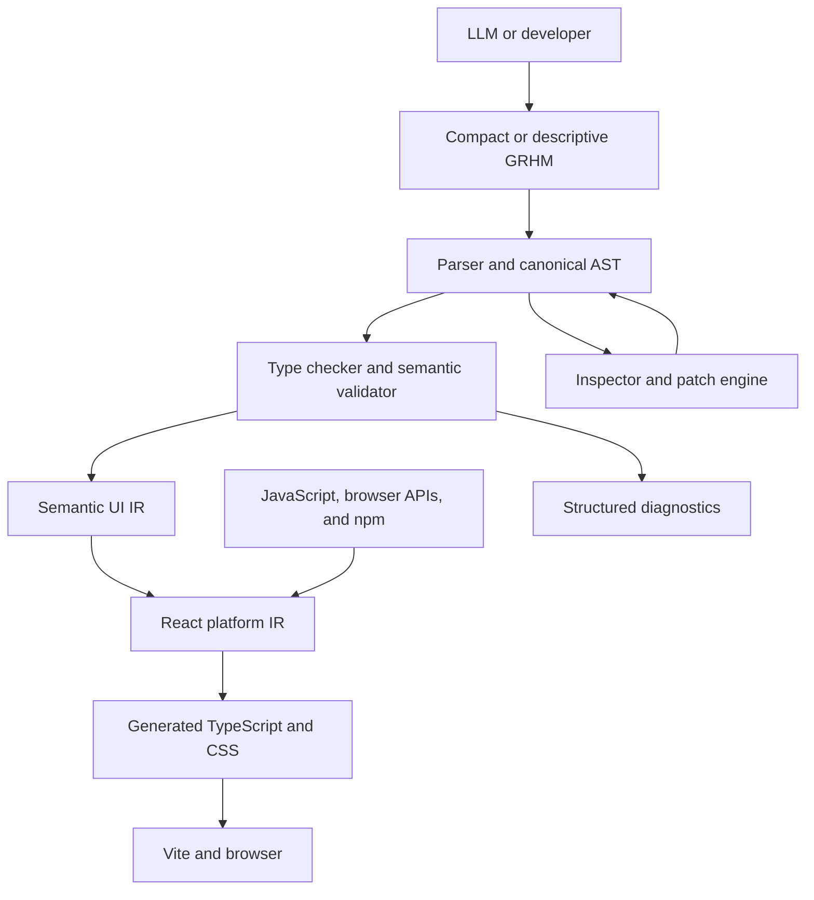

# GRHM Product Requirements Document

| Field | Value |
| --- | --- |
| Product | GRHM |
| Full name | Generative Reactive Hypermedia Metalanguage |
| Pronunciation | “Graham” |
| Document status | Draft v0.3 |
| Date | August 6, 2026 |
| Initial target | React + TypeScript + Vite applications |
| Source extension | `.grhm` |
| CLI | `grhm` |
| Owner | Product and engineering |

## 1. Executive summary

GRHM—short for **Generative Reactive Hypermedia Metalanguage** and pronounced “Graham”—is a compact, Lisp-shaped semantic language and development environment for machine-authored user-interface applications. It is not a replacement for JavaScript, TypeScript, or established web tooling. It is a higher-level layer above them:

```text
LLM or developer -> GRHM -> typed semantic IR -> React/TypeScript/CSS -> browser
                                              |
                                              +-> JavaScript/npm interoperability
```

GRHM lets a model express common application behavior with substantially fewer tokens than conventional framework code while the compiler owns correctness and routine implementation details. Stable node identities, machine-readable diagnostics, structural inspection, and a first-class patch protocol make repair and incremental editing precise and inexpensive.

The first release targets one platform only: React + TypeScript + Vite for modern web browsers. Anything not represented by a native GRHM construct remains possible through typed JavaScript, browser API, and npm interoperability. Native, backend, and data targets are outside the first release.

### 1.1 Name and identity

- **Formal name:** Generative Reactive Hypermedia Metalanguage.
- **Product name:** GRHM.
- **Pronunciation:** “Graham.”
- **Source extension:** `.grhm`.
- **CLI command:** `grhm`.
- **Naming rationale:** “Generative” identifies machine authorship, “Reactive” captures stateful event-driven applications, “Hypermedia” grounds the first target in the web, and “Metalanguage” reflects that GRHM describes intent and compiles into existing platforms.
- **Heritage:** the pronunciation is a deliberate but indirect nod to Paul Graham and the Lisp tradition. Product language must not imply affiliation, endorsement, or authorship by Paul Graham.

## 2. Product thesis

LLMs currently generate verbose framework code, repeatedly reproduce boilerplate, and often make locally plausible but structurally invalid changes. Human-oriented compiler errors and text-based file rewrites further increase repair cost.

GRHM treats software creation as a semantic compilation and repair loop:

```text
generate -> compile -> receive structured diagnostics -> inspect -> patch -> verify
```

The core research and product question is:

> What is the minimum number of model tokens required to unambiguously specify and safely modify a working application?

GRHM succeeds if it reduces that cost without creating a capability ceiling or an isolated ecosystem.

### 2.1 Alternatives considered

GRHM must beat these counterfactuals, not just idiomatic React:

| Alternative | Why it is insufficient alone |
| --- | --- |
| Models keep improving at React/TypeScript | Improves correctness but not token cost; framework mechanics, boilerplate, and whole-file edits remain the dominant cost, and diagnostics stay prose-oriented |
| Structural editing tools over TSX (AST patches on TypeScript) | Solves targeted mutation but not semantic compression; the model still authors framework mechanics, and TSX has no stable semantic identity or machine diagnostic schema |
| JSON/schema-driven UI builders | Compress layout but cannot express logic, state, effects, or interop without escape-hatching to full JavaScript, which reintroduces the original problem |
| Prompt/scaffold libraries and component kits | Reduce greenfield tokens but do not help inspection, repair, or incremental editing of existing programs |

GRHM's bet is that compression, stable identity, structured diagnostics, and patching must be designed together in one semantic layer; each alternative supplies at most one of these.

### 2.2 The cold-start constraint

No model has training data for GRHM. Until that changes, every generation session must carry the language into context: a model-facing reference, examples, and diagnostics conventions. This has two product consequences:

1. A token-budgeted, model-facing language reference is a P0 deliverable with the same status as the compiler (see FR-15).
2. All token-efficiency claims must count amortized prompt overhead (spec and example tokens) and interaction input tokens (inspection responses, diagnostics), not only generated output tokens. A language that saves 5x on output but costs more than that in mandatory context fails its own thesis.

## 3. Goals

### 3.1 Product goals

1. Let models describe common UI applications at a higher semantic level than React or DOM code.
2. Reduce generated tokens for representative UI creation and editing tasks by at least 5x against idiomatic React + TypeScript baselines.
3. Make invalid programs easy for a model to repair through deterministic, machine-readable diagnostics.
4. Make incremental changes addressable through stable node IDs and structural patches rather than whole-file regeneration.
5. Preserve practical capability parity with the web platform through JavaScript, browser API, and npm escape hatches.
6. Produce conventional, debuggable, deployable web output that works with existing tools.
7. Maintain a single canonical typed AST that can be rendered as compact model syntax, readable developer syntax, and generated TypeScript.

### 3.2 User outcomes

- An agent can create a non-trivial web interface from a compact semantic program.
- An agent can compile, inspect, and repair its output without parsing human prose.
- A developer can read, format, debug, test, and deploy the result using familiar web workflows.
- A developer can use an npm package or browser capability without waiting for a new GRHM primitive.
- An agent can modify one identified node without rewriting unrelated program regions.

## 4. Non-goals for the first release

- Replacing JavaScript or TypeScript as general-purpose languages.
- Building a new browser runtime, bundler, package registry, CSS engine, animation engine, or test runner.
- Compiling to SwiftUI, Flutter, Jetpack Compose, or other native UI targets.
- Providing first-class backend, database, SQL, email, or infrastructure primitives.
- Guaranteeing that every web capability has elegant native syntax.
- Optimizing syntax solely for human authorship.
- Supporting arbitrary macros, unrestricted compile-time execution, or multiple competing language dialects.
- Automatically making unsafe third-party packages secure.

## 5. Target users

### 5.1 Primary: coding-agent and model-platform teams

Teams building autonomous or semi-autonomous software agents that need a compact, deterministic way to generate and edit UI applications.

Primary jobs:

- Generate working interfaces with fewer model tokens.
- Receive errors in a schema that can be repaired mechanically.
- Inspect application structure without loading an entire codebase.
- Make targeted, low-risk edits and verify their effects.

### 5.2 Secondary: AI-assisted application developers

Developers who supervise model-generated applications and need readable source, conventional output, and familiar development workflows.

Primary jobs:

- Review the semantic intent of generated code.
- Run, debug, test, and deploy generated applications.
- Extend the application with browser APIs and npm libraries.
- Move between compact, readable, and generated views of the same program.

### 5.3 Tertiary: language and tool integrators

IDE, agent-runtime, and framework developers integrating GRHM through a compiler server, SDK, CLI, or language server.

## 6. Product principles

1. **Semantic density:** common expressions should represent concepts, not framework mechanics.
2. **Regular grammar:** almost all syntax follows `(operation argument...)` with a deliberately small set of special forms.
3. **Explicit semantics:** data flow, state, effects, and targets must be structurally unambiguous.
4. **Compiler-owned correctness:** types, allowed properties, accessibility rules, lifecycle behavior, and safe lowering are validated centrally.
5. **Machine-first feedback:** every diagnostic and build result has a stable, versioned structured representation.
6. **Targeted mutation:** stable identities and patches are first-class language and protocol concepts.
7. **Ecosystem leverage:** existing web tools and packages are reused instead of rebuilt.
8. **One AST, multiple views:** compact and readable source forms must resolve to identical canonical semantics.
9. **Deterministic lowering:** the same source, dependencies, compiler version, and configuration must produce equivalent output.
10. **Progressive escape:** native primitives cover common work; typed interop covers everything else.

## 7. Product scope and release priorities

Priority definitions:

- **P0:** required for the first usable public alpha.
- **P1:** required before a stable v1 release.
- **P2:** valuable follow-on capability.

| Capability | Priority | Release intent |
| --- | --- | --- |
| Parser, canonical AST, formatter | P0 | Alpha |
| Type checker and semantic validator | P0 | Alpha |
| React/TypeScript/CSS compiler | P0 | Alpha |
| Semantic UI runtime | P0 | Alpha |
| Layout, components, style, state, events, navigation, resources | P0 | Alpha |
| JavaScript/browser/npm interoperability | P0 | Alpha |
| Structured diagnostics and build results | P0 | Alpha |
| CLI: `grhm new`, `grhm dev`, `grhm build`, `grhm check`, `grhm fmt` | P0 | Alpha |
| Source maps and stable source/node correlation | P0 | Alpha |
| Stable node IDs and patch protocol | P0 | Alpha |
| Model-facing language reference and example corpus | P0 | Alpha |
| Compiler server with compile, inspect, and patch operations | P1 | v1 |
| Advanced motion, form abstractions, and expanded accessibility validation | P1 | v1 |
| Test command backed by Vitest and Playwright | P1 | v1 |
| LSP diagnostics, hover, definitions, references, rename, completion | P1 | v1 |
| Compact and readable source projections | P1 | v1 |
| Visual browser inspector | P2 | Post-v1 |
| Additional compile targets | P2 | Post-v1 research |
| First-class backend/data DSLs | P2 | Post-v1 research |

## 8. Core user journeys

### 8.1 Create an application

1. A developer or agent runs `grhm new <name>`.
2. The CLI creates a minimal GRHM project with pinned compiler/runtime versions and Vite configuration.
3. The agent writes compact semantic source.
4. `grhm check` returns structured diagnostics.
5. `grhm dev` starts the application with hot reload.
6. `grhm build` emits a conventional production web bundle.

### 8.2 Repair an invalid program

1. The agent submits source to the compiler.
2. The compiler returns an error containing a code, node ID, operation, field, received value, expected shape, source span, and repair-safe suggestions.
3. The agent inspects the affected node if more context is required.
4. The agent emits a patch against that node.
5. The compiler applies the patch transactionally and returns a new program revision plus diagnostics.

### 8.3 Modify an existing application

1. The agent queries a page or node structurally.
2. The compiler server returns only the requested subtree and relevant type/reference context.
3. The agent submits operations such as `set`, `add`, `delete`, `insert-before`, or `insert-after`.
4. The server rejects stale, invalid, or ambiguous patches without altering the program.
5. On success, affected outputs are rebuilt and the browser updates through HMR.

### 8.4 Use an unsupported capability

1. The author imports an npm module or declares a browser/JavaScript binding.
2. The type checker resolves available TypeScript declarations where present.
3. GRHM values cross the boundary through defined conversion rules.
4. Generated TypeScript contains ordinary imports and calls, preserving normal bundler behavior.
5. Missing types or unsafe dynamic calls are surfaced explicitly; they are never silently treated as safe.

## 9. Functional requirements

### FR-1: Language grammar and canonical AST — P0

The language must provide:

- A small, regular S-expression grammar.
- `.grhm` source files encoded as UTF-8.
- Literals for strings, numbers, booleans, null-like absence, identifiers, paths, lists, and records.
- Explicit constructs for bindings, functions/actions, conditionals, iteration, state, effects, modules, and imports.
- Source spans and stable semantic identities on canonical nodes.
- A versioned AST schema that can be serialized without loss.
- Deterministic parsing and formatting.
- Canonical operation names plus a controlled compact alias vocabulary.

Acceptance criteria:

- Every valid source file round-trips through parse -> format -> parse to an equivalent canonical AST.
- Supported compact aliases and canonical operation names produce equivalent canonical ASTs.
- Unknown operations and malformed expressions produce structured errors with exact source spans.
- The grammar specification and AST schema are versioned and testable.

### FR-2: Type system and semantic validation — P0

The compiler must validate:

- Primitive, collection, record, optional, resource, event, component, and node types.
- Component properties and child constraints.
- State reads/writes and event/action signatures.
- Resource states, including loading, success, empty, and error handling.
- Route parameters and navigation targets.
- Style values and design-token references.
- JavaScript interop signatures when declarations are available.
- Rules that can be proven statically without executing user code.

The type system may infer local types, but public component, module, resource, and FFI boundaries must be representable explicitly.

Acceptance criteria:

- Invalid component properties, event arguments, resource accesses, and style values fail before code generation.
- Diagnostics identify both the use site and relevant declaration where applicable.
- The compiler never generates output after a fatal type or semantic error unless explicitly invoked in a diagnostic-only partial mode.

### FR-3: Semantic UI primitives — P0

The initial standard library must cover the majority of ordinary product UI through these domains:

- Layout: vertical/horizontal stacks, grid, overlay, scroll regions, sections, spacers.
- Content: text, headings, images, icons, links, lists, tables, metrics, and media.
- Interaction: buttons, inputs, selections, toggles, dialogs, menus, tabs, tooltips.
- Composition: pages, routes, components, slots, repetition, conditional rendering.
- Presentation: tokens, styles, variants, responsive values, and states.
- Behavior: local state, derived values, events, actions, navigation, async resources.
- Quality: accessible names, focus behavior, keyboard interaction, semantic roles, loading/error/empty states.

Acceptance criteria:

- A benchmark suite of representative pages can be implemented without raw DOM or React calls for at least 80% of semantic nodes.
- Generated controls support keyboard use and accessible naming by default where semantics are known.
- Responsive behavior does not require direct CSS for the benchmark applications.

### FR-4: State, data, actions, and effects — P0

The language must distinguish pure values from effects and support:

- Local component/page state.
- App-level shared state with an explicit owner, readable across pages and components (required by benchmark applications such as a cross-page cart).
- Derived/computed values.
- Typed events and actions.
- Async resources with explicit lifecycle states.
- HTTP requests through a standard resource primitive.
- Cancellation and cleanup owned by the runtime where applicable.
- Error propagation and user-visible recovery paths.

Arbitrary side effects must be explicit and must not occur during pure rendering.

Acceptance criteria:

- The compiler rejects writes to immutable values and invalid action calls.
- Resource consumers cannot read success data without acknowledging non-success states, unless a declared default makes the access total.
- Generated React code does not require the model to manage hook ordering or routine effect cleanup.

### FR-5: Styling, tokens, responsive behavior, and motion — P0/P1

P0 must provide typed design tokens, common layout/style properties, interaction states, generated CSS, and responsive breakpoints. P1 adds declarative motion sequences, gesture transitions, stagger, duration, easing, and reduced-motion behavior.

Acceptance criteria:

- Invalid tokens, units, colors, or properties produce structured diagnostics.
- Generated styles are deterministic and do not require runtime CSS-in-JS.
- P0 responsive styles pass the benchmark suite without handwritten media queries.
- P1 motion respects the user's reduced-motion preference by default.
- Authors can fall through to CSS or a supported motion library when native constructs are insufficient.

### FR-6: JavaScript, browser API, and npm interoperability — P0

The product must support:

- Standard npm package installation through the host package manager.
- ES module imports and exports.
- Calls, construction, property access, callbacks, promises, and common value conversions.
- Type acquisition from TypeScript declaration files.
- Explicitly marked dynamic/unchecked interop when type information is unavailable.
- Browser APIs through generated TypeScript bindings.
- Source-map correlation across the interop boundary where feasible.

Acceptance criteria:

- A reference app successfully uses at least one React-compatible package, one non-React npm package, and one browser API not wrapped by the standard library.
- Typed imports surface invalid calls during `grhm check`.
- Unchecked calls are visibly marked in source/AST and produce a warning by default.
- The compiler does not invent package APIs or swallow module-resolution failures.

### FR-7: Compiler and generated output — P0

The compiler pipeline must be:

```text
source -> parser -> canonical AST -> type/semantic checks -> semantic UI IR
       -> platform IR -> React/TypeScript/CSS -> Vite
```

Generated output must:

- Be valid TypeScript, React, and CSS consumable by ordinary web tooling.
- Preserve module boundaries where practical.
- Include source maps back to GRHM source and semantic node IDs.
- Avoid requiring a custom browser engine.
- Support development and production builds.
- Be inspectable for debugging, even if developers do not normally edit it.
- In development, surface uncaught runtime errors as structured diagnostics correlated to semantic node IDs where source maps allow, so the repair loop covers runtime failures and not only compile failures.
- Support a documented ejection path: a team can stop using GRHM and continue maintaining the generated TypeScript/React project directly, with no hidden runtime coupling beyond documented helper packages.

Acceptance criteria:

- Reference applications pass TypeScript checking after generation.
- Development builds support HMR without losing unaffected local state when React/Vite can preserve it.
- Production output can be hosted as a conventional static web app.
- Repeated clean builds with fixed inputs are semantically equivalent.
- A runtime exception thrown inside a semantic node in development reports that node's ID in the structured error channel.
- An ejected reference project builds and runs with standard Vite tooling and no GRHM compiler present.

### FR-8: Structured diagnostics and results — P0

Every command and server operation must support a versioned machine-readable result. Human-readable output is a projection of that schema, not a separate source of truth.

Each diagnostic must include, when applicable:

- Schema version and severity.
- Stable error/warning code.
- Program revision.
- Node ID and source span.
- Operation and field.
- Received value or type.
- Expected value, type, or allowed set.
- Related nodes/declarations.
- One or more bounded repair suggestions when correctness is certain.

Example:

```lisp
(error
  :schema 1
  :code E214
  :severity error
  :revision 42
  :node b17
  :op motion
  :field duration
  :received duration
  :expected (dur delay ease))
```

Build results must include success, revision, diagnostics, emitted artifacts, timing, and available measurements such as semantic node count and bundle size.

Acceptance criteria:

- JSON is the required transport representation; canonical GRHM output may also be offered for token-efficient clients.
- Diagnostic codes remain stable within a major compiler version.
- Automated tests can assert diagnostics without matching prose.
- A model can locate the failing node without re-reading the entire file.

### FR-9: Stable node identity and patch protocol — P0

Semantic nodes must have stable IDs. IDs may be explicit in source or compiler-managed, but routine formatting and unrelated edits must not cause widespread identity churn.

The patch protocol must support:

- `set` or replace a field/value.
- Add or delete a property or child.
- Insert before or after a referenced child.
- Move a node within a valid structural boundary.
- Replace a subtree.
- Apply multiple operations atomically.
- Preconditions on program revision, node type, or previous value.

Example:

```lisp
(patch :revision 42 :target b17
  (set radius 16)
  (set padding 24))
```

Acceptance criteria:

- Patches are validated against the same schema and type rules as source.
- A failing multi-operation patch makes no changes.
- Stale revision preconditions return a conflict with current revision and affected node IDs.
- Successful patches return the new revision, changed nodes, invalidated outputs, and diagnostics.
- Unrelated nodes retain identity across formatting and local edits.

### FR-10: Compiler server and structural inspection — P1

The compiler server must expose local or embeddable operations for:

- Parse, format, check, compile, and build.
- Inspect a node, subtree, page, symbol, type, or reference set.
- Apply and preview patches.
- Return diagnostics and build results.
- Negotiate protocol/compiler schema versions.

Inspection responses should be bounded by depth, fields, and token/byte budget so an agent can request only necessary context.

Acceptance criteria:

- An agent can inspect a node and its relevant declaration/type context without receiving the whole program.
- Patch preview returns predicted changed nodes and diagnostics without writing files.
- The server is usable from a local CLI process and through an SDK without requiring a hosted service.

### FR-11: CLI and project workflow — P0/P1

Required P0 commands:

```text
grhm new
grhm dev
grhm build
grhm check
grhm fmt
```

P1 adds:

```text
grhm test
grhm inspect
grhm patch
```

All commands must support human output and `--json`. Commands that return semantic structures should additionally support a compact machine format.

Acceptance criteria:

- A new project can be created, run, checked, formatted, and built without manual tool configuration.
- CLI exit codes distinguish success, validation failure, build failure, and internal tool failure.
- `grhm fmt --check` is suitable for continuous integration.
- `grhm dev` reports source-correlated diagnostics without terminating on ordinary source errors.

### FR-12: Multiple representations — P1

The system must support:

1. Compact canonical source optimized for model token cost.
2. Descriptive source optimized for developer reading and review.
3. Canonical typed AST/IR for tools.
4. Generated TypeScript/CSS for debugging and integration.

Aliases and projections must not introduce semantic differences. Positional compact forms are allowed only when their arity and types make interpretation unambiguous.

Acceptance criteria:

- Compact -> AST -> descriptive -> AST preserves semantic equivalence.
- Diagnostics can point to the active source representation and the canonical node.
- Token benchmarks report results for compact and descriptive forms separately.

### FR-13: Language server and editor support — P1

The LSP must provide:

- Diagnostics.
- Formatting.
- Hover types and documentation.
- Go to definition and find references.
- Completion filtered by semantic position and expected type.
- Safe symbol rename.
- Semantic highlighting.
- Node ID visibility and copy actions.

Acceptance criteria:

- Editor results use the same compiler/type-checker implementation as the CLI.
- Rename and definition operations work across project modules.
- Completion does not suggest invalid properties for a known component or operation.

### FR-14: Testing — P1

`grhm test` must lower semantic tests to existing test infrastructure rather than create a new runner. Initial support should use Vitest for program/unit behavior and Playwright for browser behavior.

Acceptance criteria:

- Tests can locate semantic nodes by stable identity or accessible semantics rather than generated class names.
- Failures map back to GRHM source and node IDs.
- Existing Vitest and Playwright configuration can be extended for advanced cases.

### FR-15: Model-facing language reference and grounding corpus — P0

Because no model is trained on GRHM, the language ships with materials designed to be placed in a model's context:

- A canonical, versioned language reference written for model consumption, with a declared maximum token budget measured against named tokenizers.
- A curated example corpus covering every P0 primitive, common composition patterns, diagnostic repair transcripts, and patch usage.
- Reference and corpus versions locked to the language/AST schema version they describe.
- Guidance for agent integrators on which subset of the reference to include for creation, inspection, and repair tasks respectively.

Acceptance criteria:

- A held-out model given only the reference, corpus excerpts, and a task description meets the alpha first-pass compile target without fine-tuning.
- The full reference fits within its declared token budget on every named tokenizer, and the budget is tracked in CI as the language grows.
- Every language or schema change that affects authoring updates the reference in the same release.

## 10. Illustrative source

This example is informative, not a frozen syntax specification:

```lisp
(app store
  (data
    (resource products "/api/products"))

  (page "/" home
    (v
      (hero
        (txt "New arrivals")
        (btn "Shop" (nav "/products")))

      (grid :cols 4 :cols-sm 1
        (each p products.data
          (card :id p.id
            (img p.image :alt p.name)
            (txt p.name)
            (money p.price)
            (click (nav (path "/products/{id}" :id p.id))))))))
```

The equivalent readable projection may expand aliases such as `v`, `btn`, and `txt`, while both forms resolve to the same AST.

## 11. Architecture



### 11.1 Major components

- **Parser/formatter:** reads both source projections and emits canonical formatting.
- **Canonical AST:** versioned, serializable structure with source spans and stable IDs.
- **Type checker/validator:** owns language, component, style, accessibility, and interop validation.
- **Semantic UI IR:** platform-neutral enough to preserve future options, but designed only to satisfy the web target in v1.
- **React lowering/runtime:** maps semantic UI behavior to React and minimal runtime helpers.
- **CSS generator:** emits deterministic static CSS plus required state/responsive rules.
- **Interop layer:** maps typed GRHM calls and values to TypeScript/JavaScript.
- **Patch engine:** validates revisioned structural mutations and preserves identity.
- **Compiler server/SDK:** exposes compiler and inspection operations to agents and tools.
- **CLI/LSP:** human and editor interfaces over the same compiler APIs.

### 11.2 Reused ecosystem components

| Need | Initial implementation |
| --- | --- |
| Browser runtime | JavaScript |
| UI target | React |
| Generated language | TypeScript |
| Dev/build | Vite |
| Fast transforms | esbuild or the transform selected by Vite |
| Package ecosystem | npm-compatible package manager |
| Animation escape hatch | Web Animations API and compatible libraries |
| Canvas/3D/GPU | Browser APIs and packages such as Three.js |
| Unit testing | Vitest |
| Browser testing | Playwright |
| Deployment | Conventional static or Node-compatible output |

## 12. Non-functional requirements

### 12.1 Performance

- P50 incremental check for a 1,000-node reference project: under 300 ms on the reference development machine.
- P95 incremental check for a local single-node edit: under 1 second.
- Warm patch validation and affected-output calculation: under 200 ms P50.
- Runtime overhead versus an equivalent idiomatic React implementation: no more than 10% in the defined benchmark suite, excluding application-specific third-party packages.
- Generated production bundles must be measurable and attributable to runtime, app code, and third-party dependencies.

### 12.2 Reliability and determinism

- No compiler crash for syntactically valid input in the conformance corpus.
- Compiler failures return an internal-error code and reproducible context without corrupting source.
- Patch application is atomic.
- Schema and language versions are explicit in machine-facing requests and responses.
- Lockfiles and pinned compiler/runtime versions are respected.

### 12.3 Security

- The compiler must not execute application code during parse, format, or type-check phases.
- Compile-time extensions are disabled in v1 unless they run in a separately specified sandbox.
- FFI and npm code have the same authority as ordinary application JavaScript and must be labeled accordingly in documentation and inspection output.
- Client builds must warn on patterns that appear to embed declared secrets.
- HTML injection and unsafe URL/script sinks require explicit unsafe operations and warnings.
- HTTP/resource primitives must not imply server-side secret protection when compiling for the browser.

### 12.4 Accessibility

- Standard interactive primitives generate appropriate semantic HTML and keyboard behavior by default.
- Missing accessible names, invalid role relationships, and common focus errors are compiler diagnostics when statically knowable.
- Escape hatches that bypass semantic primitives are visible to accessibility checks.

### 12.5 Compatibility

- The initial supported browser policy targets current evergreen browsers and is declared in project configuration.
- The toolchain supports the active LTS Node.js line selected for the release.
- The compiler publishes a compatibility matrix for language, AST schema, runtime, React, and Vite versions.

### 12.6 Observability and privacy

- The compiler and CLI work fully offline after dependencies are installed.
- Telemetry is opt-in during alpha unless a later policy is explicitly approved.
- Any telemetry must avoid source code, prompts, application data, file paths, and imported secrets by default.
- Benchmark collection records compiler/runtime versions and anonymized performance measurements only with consent.

## 13. Success metrics

### 13.1 North-star metric

**Verified semantic change cost:** median model tokens required to complete a benchmark task and reach a passing compile/test result.

This measures both compression and repair efficiency. A short first attempt that needs repeated rewrites is not considered successful.

Token accounting rules:

- Output tokens include all generated source, patches, and tool arguments.
- Input tokens include the amortized model-facing language reference and examples (FR-15), inspection responses, and diagnostics consumed during the task.
- Results are reported as output-only and total (input plus output) so prompt overhead cannot hide a regression.
- Comparative baselines receive equivalent scaffolding (framework documentation and examples of comparable size) so the comparison is not biased against conventional code.

### 13.2 Alpha exit metrics

| Metric | Target |
| --- | --- |
| Token reduction for greenfield benchmark apps | >= 5x median vs. idiomatic React + TypeScript source generated for the same requirements |
| Token reduction for targeted edit tasks | >= 10x median vs. whole-file/framework-code editing baseline |
| Native semantic coverage | >= 80% of benchmark UI nodes without direct React/DOM escape hatches |
| Capability escape-hatch validation | 100% of reference interop scenarios build and run |
| First-pass compile rate on held-out prompts | >= 70%, and not more than 10 points below the same model writing idiomatic React for the same tasks |
| Repair success after <= 2 structured-diagnostic rounds | >= 90% |
| Accessibility conformance of benchmark output | 0 serious/critical automated-audit violations (e.g., axe-core) on benchmark apps built without escape hatches |
| Patch locality | >= 95% of targeted edits change only the intended semantic subtree plus compiler-owned generated output |
| Diagnostic addressability | 100% of compiler diagnostics contain code and source span; >= 95% of semantic diagnostics contain node ID |
| Compiler stability | >= 99.5% successful compiler operations excluding user validation failures |

All comparative metrics require a published benchmark specification, fixed model/version/settings, equivalent product behavior, and retained raw results.

## 14. Benchmark plan

The benchmark suite must include at least:

1. Marketing page with responsive sections; motion added when P1 motion ships, with a motion-free P0 variant.
2. CRUD dashboard with navigation, table, filters, modal, and form validation built from P0 input/state/event primitives; the P1 form abstraction must reduce its token cost, not enable it.
3. Commerce catalog with resources, grid, product page, and a cart carried in app-level shared state across pages.
4. Settings application with tabs, local state, async save, and errors.
5. Canvas or 3D feature implemented through interop.
6. Accessibility repair task.
7. Targeted style change by node ID.
8. Structural insertion and move by patch.
9. Invalid property, event, type, route, and resource-state repair tasks.
10. npm package integration task unknown to the native standard library.
11. Runtime-failure repair task: diagnose and fix a defect that compiles but throws at runtime, using node-correlated runtime diagnostics.

Every task must be expressible with P0 capabilities (plus interop where the task is explicitly about interop); P1 features may improve scores but must not be prerequisites for completing the suite.

For each task, measure initial output tokens, repair tokens, total input tokens consumed, compile attempts, elapsed tool time, output behavior, bundle size, and unintended semantic changes.

## 15. Rollout plan

### Phase 0: hypothesis validation and executable specification

- Decide the compiler implementation language (open decision 1) before any durable implementation begins; earlier experiments are explicitly throwaway.
- Validate the core hypothesis on paper before building the compiler: hand-write GRHM and idiomatic React for three or more benchmark apps, measure token counts across named tokenizers, and run spec-in-prompt comprehension tests where held-out models author and repair GRHM given only the draft reference.
- Freeze the minimum grammar and AST v0 schema.
- Build parser, formatter, AST serializer, and conformance corpus.
- Run tokenizer experiments for candidate compact vocabulary.
- Define benchmark apps and conventional React baselines before optimizing results.
- Draft the model-facing language reference (FR-15) alongside the grammar so authoring cost is designed in, not documented after.

Exit criteria: the same small programs round-trip across compact, AST, and readable forms with stable node identity; hand-written comparisons show at least 3x total-token reduction and models demonstrate spec-in-prompt authoring competence. If the hand-written comparison cannot reach 3x, or held-out models cannot author valid GRHM from the reference, the project pauses and revisits language design rather than proceeding to Phase 1.

### Phase 1: vertical-slice compiler alpha

- Implement P0 UI primitives, state/events/resources, type checking, React/CSS lowering, and Vite integration.
- Deliver `grhm new`, `grhm dev`, `grhm build`, `grhm check`, and `grhm fmt`.
- Add JSON diagnostics, source maps, JS/npm interop, and patch transactions.

Exit criterion: all benchmark apps compile and run using P0 capabilities; alpha metrics are measured and material failures are understood.

### Phase 2: agent development environment beta

- Add compiler server, structural inspection, SDK, patch previews, tests, and LSP.
- Harden ID stability, schema versioning, accessibility checks, and compact/readable projections.
- Integrate with at least one coding-agent harness.

Exit criterion: an agent completes creation and editing benchmarks through compiler-server APIs without reading generated TypeScript for routine tasks.

### Phase 3: v1 stabilization

- Resolve conformance gaps and performance regressions.
- Publish compatibility policy, migration tooling, security model, and extension guidance.
- Freeze language/AST/protocol v1 within documented compatibility guarantees.

Exit criterion: v1 metrics are met, reference projects pass CI, and no P0 security or data-corruption issues remain.

## 16. Risks and mitigations

| Risk | Impact | Mitigation |
| --- | --- | --- |
| The DSL becomes another verbose UI framework | Token and simplicity goals fail | Maintain token benchmarks; require a semantic-density justification for new primitives |
| Abbreviations reduce debuggability | Developers cannot review generated work | Preserve readable projection, hover docs, and canonical AST; restrict ambiguous positional forms |
| Native primitives create a capability ceiling | Real apps cannot adopt the language | Ship typed JS/npm/browser interop in the alpha, not as a later add-on |
| FFI erodes safety | Compiler guarantees become misleading | Mark unchecked boundaries, import TS declarations, and report unsafe operations |
| Stable IDs churn or collide | Patches become unsafe | Use deterministic identity rules, explicit-ID validation, revision preconditions, and identity conformance tests |
| Generated output is hard to debug | Developers abandon the tool | Provide source maps, readable generated TypeScript, and source/node correlation |
| Multi-target ambition dilutes v1 | No target becomes production-ready | Support only React/TypeScript/Vite in v1 while keeping the semantic/platform IR boundary internal |
| Compiler/runtime abstractions hurt performance | Apps feel slower or bundles grow | Benchmark against idiomatic React, keep runtime minimal, and prefer compile-time lowering |
| Models cannot author GRHM reliably without training data (cold start) | The language is unusable regardless of its design quality | Treat the model-facing reference and example corpus as P0 (FR-15); validate spec-in-prompt authoring in Phase 0 before building the compiler; test across model families |
| Mandatory in-context spec and examples erase output-token savings | The token thesis fails silently | Enforce a tracked token budget on the reference; report total-token metrics alongside output-only metrics in every benchmark |
| Models overfit the language's examples | Held-out performance disappoints | Maintain private held-out tasks and test across multiple model families/tokenizers |
| Package ecosystem changes break builds | Reliability declines | Respect lockfiles, publish compatibility matrices, and test supported toolchain combinations |
| Arbitrary compile-time power creates supply-chain risk | Source checking executes untrusted code | Exclude unrestricted macros/plugins from v1 and keep type checking non-executing |

## 17. Open decisions

These decisions must be resolved during Phase 0. Decision 1 blocks the start of durable Phase 0 implementation and must be resolved first.

1. **Implementation language:** TypeScript offers ecosystem alignment; Rust or another systems language may improve parser/compiler performance and embeddability. Because Phase 0 builds the parser, formatter, and serializer, this decision cannot wait for the end of the phase.
2. **Stable ID representation:** explicit source IDs, compiler-managed sidecar IDs, deterministic structural IDs, or a hybrid.
3. **Canonical transport:** JSON is required; decide whether compact S-expression transport is normative or optional.
4. **Type-system depth:** structural versus nominal records, effect typing, generics, and how much TypeScript type information crosses the FFI boundary.
5. **Source ownership:** whether compact or descriptive syntax is stored on disk by default, and whether generated IDs appear in authored source.
6. **Runtime scope:** the minimum runtime required beyond generated React code.
7. **Styling model:** exact token schema, CSS generation strategy, variant composition, and escape-hatch syntax.
8. **Package manager UX:** delegate fully to npm-compatible tools or wrap common operations in the GRHM CLI.
9. **Patch persistence:** rewrite canonical source directly, maintain an operation log, or support both.
10. **Versioning policy:** compatibility and migration rules for language syntax, AST, compiler protocol, and runtime.

## 18. Decisions already made by this PRD

- GRHM is a machine-native semantic application language, not a human-first general-purpose Lisp.
- The first product domain is user-interface application development.
- The only v1 output target is React + TypeScript + Vite for the web.
- Existing bundling, package, testing, browser, and deployment ecosystems are reused.
- JavaScript/npm/browser interoperability is a P0 requirement and the mechanism for practical capability parity.
- Structured diagnostics and stable node patches are core product behavior, not ancillary tooling.
- Compact and descriptive forms share one canonical typed AST.
- The model-facing language reference and example corpus are P0 deliverables, and token metrics count their amortized in-context cost.
- Generated output must remain independently maintainable; a documented ejection path is a product requirement, not a courtesy.
- Backend and multi-platform compilation are future research, not v1 commitments.
- Phase 1 cannot begin until Phase 0's hand-written token comparison and spec-in-prompt authoring tests pass their thresholds.

## 19. Definition of v1 done

GRHM v1 is complete when:

1. A model can create, inspect, repair, and incrementally modify all benchmark applications through the documented language and compiler-server interfaces.
2. The generated applications run as conventional React/Vite projects and can use arbitrary compatible npm packages through explicit interop.
3. Language, AST, patch, diagnostic, and compiler-server schemas are versioned and documented.
4. Source maps, node identity, atomic patching, formatting, CLI, LSP, and test integration pass their conformance suites.
5. The quality, token-efficiency, accessibility, stability, and performance thresholds in this PRD are met or explicitly revised with published evidence.
6. No unresolved P0 security, correctness, source-corruption, or patch-identity defect remains.

## 20. Glossary

| Term | Meaning |
| --- | --- |
| GRHM | The Generative Reactive Hypermedia Metalanguage and, when context is broad, its development toolchain |
| `grhm` | The command-line executable |
| `.grhm` | The source-file extension |
| Semantic node | A typed application concept in the canonical AST, such as a page, resource, component, or action |
| Stable node ID | An identifier intended to survive formatting and unrelated local edits so tools can inspect and patch a node safely |
| Compact form | Token-efficient GRHM syntax intended primarily for model generation |
| Descriptive form | Readable GRHM syntax intended primarily for developer review and debugging |
| Canonical AST | The versioned, typed semantic representation shared by all source projections and tools |
| Patch | A revision-checked structural mutation applied atomically to the canonical program |
| Compiler server | The local or embeddable API that exposes parse, check, compile, inspect, preview, and patch operations |
| Interop boundary | An explicit transition from compiler-checked GRHM semantics to JavaScript, browser APIs, or npm packages |
